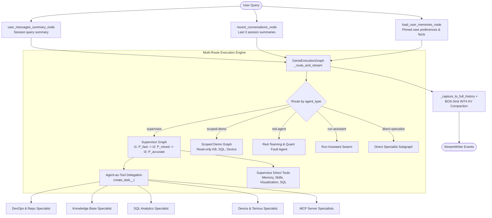

# Pocket-Genie Architecture

## 1. Execution Lifecycle & Parallel State Pre-Processing

Each incoming request passes through three parallel pre-processing nodes before entering the main streaming execution node (`GenieExecutionGraph` in `src/pocket_genie/core/graph.py`):

1. **`user_messages_summary_node`**: Incrementally updates the summary of user queries across the active session.
2. **`recent_conversations_node`**: Retrieves and caches the 3 most recent session summaries for the active workspace.
3. **`load_user_memories_node`**: Loads pinned user preferences and workspace facts from `SessionMemoryStore`.

---

## 2. Core Design Principles

### Agent-as-a-Tool Delegation & Schema Narrowing (`core/delegation.py`)
Rather than exposing 20+ tools simultaneously to a 4-bit quantized model, the Supervisor invokes domain specialists via typed tools named `create_task_<agent_id>_t<tier>`. Each specialist runs in an isolated subgraph with only 2–5 domain-scoped tools, streaming progressive `ToolCallChunk` fragments (`ToolCallChunkAccumulator`) and `subagent_reasoning` events. Unrecoverable specialist exceptions are returned as `[DELEGATION_ERROR]` observations so the Supervisor can recover or escalate precision tier.

### Quantization-Aware Tier Escalation (`quant/` & `middlewares/fallback.py`)
`TieredAgentFactory` binds three activation precision profiles sharing the same 4-bit weight tensor (`315.1 MB`):
- **Tier 1 (`t1` — `P_fast`):** Uniform `W4A8` with 3-boundary SmoothQuant (`8.00` effective activation bits).
- **Tier 2 (`t2` — `P_mixed`):** Promotes only the high-kurtosis `mlp.down_proj` layers (`Layers 0, 18, 21–23`, `<5%` MAC overhead) to `UINT16` activations (`8.24` effective activation bits) paired with `FastJsonSchemaParser` grammar constraints.
- **Tier 3 (`t3` — `P_accurate`):** Full in-place `W4A16` activation promotion (`16.0` effective activation bits, `0.0 MB` extra weight RAM).

During decoding, `TokenPrecisionRouter` (`quant/entropy_router.py`) monitors the top-2 logit margin $\Delta z_t = z_{(1),t} - z_{(2),t}$ and token entropy $H(p_t)$, promoting individual high-uncertainty decision tokens while keeping structural JSON tokens on `P_fast`.

### Prompt-Prefix Caching & BOS-Sink `INT4` KV Cache (`quant/kv_cache.py`)
System prompts rendered by `render_supervisor_system_prompt` avoid dynamic wall-clock timestamps, pinning `session_created_at` and session-start memories while querying live time on demand via `memory.get_current_datetime`. `BOSSinkINT4KVCache` pins the static system/schema prefix and compresses middle tool-observation history using per-channel asymmetric `INT4` for Keys (`K`) and per-token asymmetric `INT4` for Values (`V`), while preserving token-0 BOS attention sinks and the recent sliding window in `FP16`.

---

## 3. Nine-Stage Middleware Pipeline (`middlewares/`)

1. **`MessageSanitizerMiddleware`**: Removes orphaned tool messages and strips unclosed `<tool_call>` tags from interrupted streams.
2. **`DynamicSupervisorPromptMiddleware`**: Injects prefix-cacheable system prompts, pinned user memories, and the skill catalog.
3. **`CustomSummarizationMiddleware`**: Compacts older conversation turns into a rolling `RunningSummary` when token or message limits are exceeded.
4. **`ProjectScopedToolsMiddleware`**: Filters out project-scoped or mutating tools when running in `scoped-demo` or unscoped contexts.
5. **`FallbackMiddleware`**: Escalates across `t1 -> t2 -> t3` on model refusal, corrupted tool JSON, or backend faults.
6. **`RefusalDetectionMiddleware`**: Flags model refusals and malformed tool syntax for recovery.
7. **`RepeatToolCallBreakerMiddleware`**: Hashes canonical `(tool_name, arguments)` invocations to halt cyclical tool loops and escalate precision tier.
8. **`SQLTableAllowlistMiddleware`**: Enforces read-only `SELECT` semantics (including CTE alias resolution) against `sql_table_registry.json`.
9. **`HumanInTheLoopMiddleware`**, **`ToolResultTruncationMiddleware`**, & **`ToolErrorMiddleware`**: Gates mutating tools for user approval, truncates oversized outputs along line boundaries, and formats tool exceptions into `[TOOL_ERROR]` strings.
