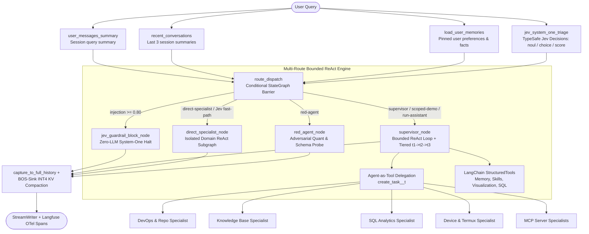

# Pocket-Genie Architecture (`v0.3.0`)

## 1. Compiled LangGraph `StateGraph`, LangChain Adapters & Langfuse Tracing

Each incoming request executes through a compiled **`langgraph.graph.StateGraph`** (`GenieExecutionGraph` in `src/pocket_genie/core/graph.py`) backed by `InMemorySaver` thread checkpointing and wrapped by **`GenieLangfuseTracer`** (`src/pocket_genie/observability/langfuse_tracer.py`) for OpenTelemetry span/generation/guardrail observability.

*(On `aarch64` Android Termux where native extensions are omitted, `GenieExecutionGraph` automatically falls back to a lightweight `ThreadPoolExecutor` graph runner executing the identical node topology.)*

### Parallel Pre-Processing Fan-Out (`START -> route_dispatch`)
1. **`user_messages_summary`**: Incrementally updates the rolling summary of user queries across the active session.
2. **`recent_conversations`**: Retrieves and caches the 3 most recent session summaries for the active workspace.
3. **`load_user_memories`**: Loads pinned user preferences and workspace facts from `SessionMemoryStore`.
4. **`jev_system_one_triage`**: Queries **TypeSafe Jev** (`POST https://openrouter.ai/api/alpha/decisions` with calibrated offline fallback) in a single batched System-One call (`prompt_injection` `noul`, `mutating_intent` `noul`, `route_specialist` `choice`, and `precision_tier` `score`) to short-circuit prompt injections, pre-escalate precision tiers (`t1 -> t2/t3`), and bypass Supervisor prefill on high-confidence single-domain queries.

---

## 2. Core Design Principles

### Bounded ReAct Agent-as-a-Tool Delegation (`core/delegation.py` & `core/supervisor_agent.py`)
Rather than exposing 20+ tools simultaneously to a 4-bit quantized model, the Supervisor invokes domain specialists via typed tools named `create_task_<agent_id>_t<tier>`. Both the Supervisor and each specialist run bounded multi-step ReAct loops (`max_steps=3`), chaining sequential tool calls (`git_status` $\rightarrow$ `git_diff` $\rightarrow$ synthesis), streaming progressive `ToolCallChunk` fragments (`ToolCallChunkAccumulator`), and pausing cleanly whenever `HumanInTheLoopMiddleware` emits `[HITL_PENDING:<id>]`.

### LangChain & Langfuse Interoperability (`integrations/langchain_bridge.py` & `observability/langfuse_tracer.py`)
- **`ToolSpec.to_langchain_tool()`**: Dynamically synthesizes Pydantic v2 `args_schema` models from sanitized JSON Schemas to expose any built-in or MCP tool as a `langchain_core.tools.StructuredTool`.
- **`PocketGenieChatModel`**: Implements `langchain_core.language_models.chat_models.BaseChatModel` (`bind_tools`, `usage_metadata`, `response_metadata["quant_telemetry"]`) over any Pocket-Genie backend.
- **`GenieLangfuseTracer` & `LangfuseTracingMiddleware`**: Exports OpenTelemetry-native Langfuse v5 `agent`, `generation`, `tool`, and `guardrail` observations alongside numeric quantization scores (`effective_act_bits`, `promoted_token_ratio`, `kv_memory_saved_mb`), plus a local ring buffer inspectable via `GET /api/v1/traces`.

### Live Quantization Runtime & Tier Escalation (`quant/hf_backend.py` & `middlewares/fallback.py`)
`SharedHFQuantRuntime` and `QuantizedPyTorchBackend` (`--backend hf-quant`) execute real HuggingFace/PyTorch models (`Qwen/Qwen2.5-0.5B-Instruct`, `1.5B`, `3B`) on Apple Silicon MPS, CUDA, or CPU:
1. **Empirical Kurtosis Calibration (`calibrate_layer_sensitivities`):** Measures per-layer excess kurtosis $\kappa$ and `W4A8` MSE in a live forward pass to identify SwiGLU `mlp.down_proj` outlier projections automatically, then migrates channel scales via Boundary-C SmoothQuant (`migrate_swiglu_down_proj_scale`).
2. **Zero-Weight-Overhead Activation Profiles (`0.0 MB` fallback RAM):**
   - **Tier 1 (`t1` — `P_fast`):** Uniform `W4A8` (`8.00` effective activation bits) + mid-decode single-token precision promotion via `TokenPrecisionRouter`.
   - **Tier 2 (`t2` — `P_mixed`):** Selective `UINT16` activation hooks on top-kurtosis `mlp.down_proj` layers (`~8.57` effective activation bits) + cached-FSM `FastJsonSchemaParser` (`TokenEnforcer`) grammar constraints.
   - **Tier 3 (`t3` — `P_accurate`):** Full in-place `W4A16` (`16.0` effective activation bits) + `FastJsonSchemaParser`.
3. **Live Logprobs Routing (`OpenAICompatibleBackend`):** Requests `logprobs=True, top_logprobs=5` from Ollama/`llama-server` endpoints so `TokenPrecisionRouter` computes genuine $\Delta z_t$ margins and Shannon entropy on remote/GGUF backends as well.
4. **Prompt-Prefix Caching & BOS-Sink `INT4` KV Cache (`quant/kv_cache.py`):** Pins static system/schema prefixes and compresses middle tool history using per-channel asymmetric `INT4` for Keys (`K`) and per-token asymmetric `INT4` for Values (`V`), preserving BOS sink tokens (`0..3`) and recent window (`W=64`) in `FP16`.

---

## 3. Ten-Stage Middleware Pipeline (`middlewares/`)

1. **`MessageSanitizerMiddleware`**: Removes orphaned tool messages and strips unclosed `<tool_call>` tags from interrupted streams.
2. **`DynamicSupervisorPromptMiddleware`**: Injects prefix-cacheable system prompts, pinned user memories, and the skill catalog.
3. **`CustomSummarizationMiddleware`**: Compacts older conversation turns into a rolling `RunningSummary` when token or message limits are exceeded.
4. **`ProjectScopedToolsMiddleware`**: Filters out project-scoped or mutating tools when running in `scoped-demo` or unscoped contexts.
5. **`LangfuseTracingMiddleware`**: Records nested `generation`, `tool`, and `guardrail` spans + quantization telemetry scores into Langfuse.
6. **`FallbackMiddleware`**: Escalates across `t1 -> t2 -> t3` on model refusal, corrupted tool JSON, or backend faults.
7. **`RefusalDetectionMiddleware`**: Flags model refusals and malformed tool syntax for recovery.
8. **`RepeatToolCallBreakerMiddleware`**: Hashes canonical `(tool_name, arguments)` invocations to halt cyclical tool loops and escalate precision tier.
9. **`SQLTableAllowlistMiddleware`**: Enforces read-only `SELECT` semantics (including CTE alias resolution) against `sql_table_registry.json`.
10. **`HumanInTheLoopMiddleware`**, **`ToolResultTruncationMiddleware`**, & **`ToolErrorMiddleware`**: Gates mutating tools for user approval (with post-approval LLM synthesis), truncates oversized outputs along line boundaries, and formats tool exceptions into `[TOOL_ERROR]` strings.
